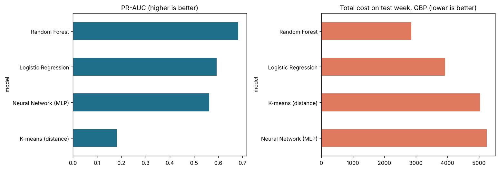

# UK Card Fraud Detection

Detecting fraudulent debit and credit card payments for a UK bank, comparing four machine learning approaches on a **synthetic dataset of 250,000 UK card transactions** where only **0.25% are fraud**.



## Why this project

Card fraud costs UK banks and their customers hundreds of millions of pounds a year, and most of it is "card not present" (online) fraud. A fraud model has to catch as much of it as possible **without** blocking so many genuine payments that customers get fed up.

This project is a UK-focused rebuild of a university project that compared logistic regression, K-means and a neural network on the European Kaggle credit card dataset (see [Credits](#credits)). I rebuilt it with:

- **Interpretable UK features** instead of anonymised `V1..V28` columns (channel, merchant type, contactless £100 cap, SCA / 3-D Secure, velocity, distance from home)
- **A time-based split** (train on 1–21 Sep, tune on 22–25 Sep, test on 26–30 Sep) — the way a bank would really use a model
- **Leak-free pipelines** — scaling and SMOTE happen only on training data
- **A £ cost metric** for choosing the decision threshold
- **A Random Forest** added (the original paper's suggested next step)

## Results (test week, 26–30 Sep 2026 — 41,384 payments, 112 fraud)

| Model | Fraud caught (recall) | Precision | PR-AUC | Frauds missed | False alarms | Cost (£) |
|---|---|---|---|---|---|---|
| **Random Forest** | **72%** | **44%** | **0.68** | **31** | **102** | **2,860** |
| Logistic Regression | 67% | 36% | 0.59 | 37 | 132 | 3,934 |
| Neural Network (MLP) | 64% | 35% | 0.56 | 40 | 132 | 5,254 |
| K-means (distance to centre) | 47% | 20% | 0.18 | 59 | 216 | 5,038 |
| *No model at all* | *0%* | – | – | *112* | *0* | *14,529* |

Cost = value of missed fraud + £5 per false alarm. The best model cuts the loss by about **80%** versus doing nothing.

Every model scores **99.3–99.7% accuracy** — and so does a model that never flags anything (99.8%). That's why accuracy is not used to compare them.

### Key findings
1. **Accuracy is misleading** with rare fraud; recall, precision, PR-AUC and £ cost tell the real story.
2. **Random Forest performed best**; **Logistic Regression** came second and is the easiest to explain to a risk or compliance team.
3. **K-means doesn't find fraud as a cluster** — fraud is too rare. Using distance from the nearest cluster centre as an anomaly score helps, but supervised models are far stronger.
4. **The threshold is a business decision.** Choosing it on the validation week by £ cost works much better than the default 0.5.
5. The Random Forest relied most on **transaction velocity**, **new merchants**, **channel**, **account age** and **merchant type** (permutation importance, notebook 05).

## Project structure

```
uk-card-fraud-detection/
├── data/
│   ├── generate_uk_transactions.py   # creates the synthetic dataset (fixed seed, reproducible)
│   └── uk_card_transactions.csv.gz   # 250,000 transactions
├── notebooks/
│   ├── 01_eda.ipynb                  # what does fraud look like?
│   ├── 02_logistic_regression.ipynb  # plain vs class weights vs SMOTE, threshold by £ cost
│   ├── 03_kmeans.ipynb               # unsupervised clustering + anomaly score
│   ├── 04_neural_network.ipynb       # MLP with oversampling
│   └── 05_random_forest_and_comparison.ipynb
├── src/utils.py                      # shared features, split, preprocessing, evaluation
├── results/                          # metrics saved by each notebook
├── images/                           # charts used in this README
└── requirements.txt
```

## How to run

```bash
pip install -r requirements.txt
python data/generate_uk_transactions.py    # optional - the data is already included
jupyter notebook                           # then run notebooks 01 -> 05 in order
```

Notebook 05 reads the results saved by 02–04, so run them in order.

## The data

The dataset is **synthetic** — generated by `data/generate_uk_transactions.py` — because real bank transaction data is confidential. The fraud patterns are modelled on how UK card fraud typically works (online purchases, card testing with tiny amounts, bursts of activity, missing Strong Customer Authentication, new accounts), and 20% of fraud is deliberately disguised to look normal so the problem isn't too easy. **The numbers are not real UK fraud statistics.**

| Column | Meaning |
|---|---|
| `amount_gbp` | Payment amount (£) |
| `merchant_category` | grocery, fuel, online_retail, electronics, gambling, travel… |
| `channel` | chip_pin, contactless (max £100), online, mobile_wallet, atm |
| `is_international` / `distance_from_home_km` | Where the payment happened |
| `txn_count_last_1h` / `_24h` | Velocity |
| `is_new_merchant` | First payment to this merchant |
| `sca_authenticated` | Passed SCA / 3-D Secure (online) |
| `failed_pin_attempts`, `account_age_months`, `customer_avg_spend_gbp` | Account behaviour |
| `is_fraud` | Target (1 = fraud) |

## Tools
Python, pandas, NumPy, scikit-learn, imbalanced-learn (SMOTE), Matplotlib, Jupyter.

## Credits
Inspired by *Data Science for Kaggle: Final Project* by Georgy Marrero, Makena Schwinn and Sunny Zhang (2017), which compared logistic regression, K-means and a neural network on the [Kaggle Credit Card Fraud dataset](https://www.kaggle.com/datasets/mlg-ulb/creditcardfraud). This repo uses a new UK dataset, new code and a different evaluation approach.
